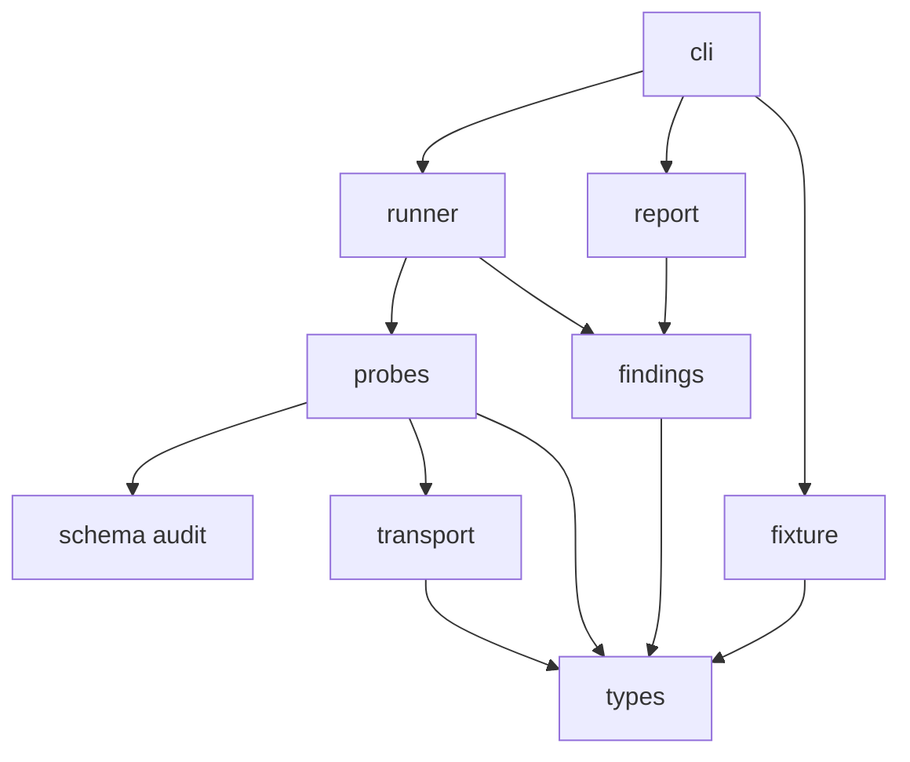

# Contributing

## Setup

```sh
uv sync --frozen --group dev
uv run pytest
uv run ruff check .
uv run ruff format --check .
uv run mypy --strict src/mcp_cross_exam tests tools
uv run lint-imports
```

Tests may open sockets only to `127.0.0.1` and `::1`.

## Layers



Higher boxes may import lower ones. `report` does not import `runner`. `fixture` does not import the schema auditor. Only `cli` opens a stdio or HTTP adapter.

## Adding a probe

Add the probe class next to the others and register it. Set `impact`, `summary`, and `spec`. Add one fixture defect with the same id, and keep `fixture serve --clean` free of findings. A probe that cannot be triggered, or that fires on a clean server, is not done.

## Release

1. Move `Unreleased` to a version section of one sentence per entry.
2. Set `__version__` to that version.
3. Tag `vX.Y.Z`. A tag that contains `rc` publishes to TestPyPI. Any other tag publishes to PyPI.
4. The release workflow builds the wheel, checks the changelog, and uploads attestations.
